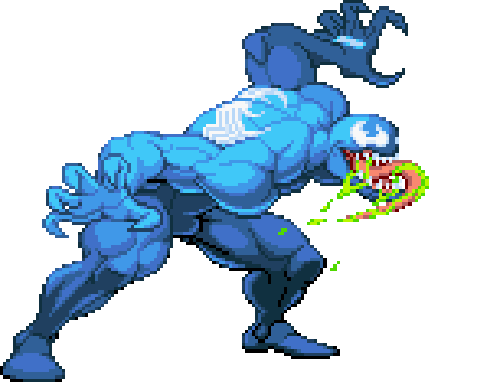
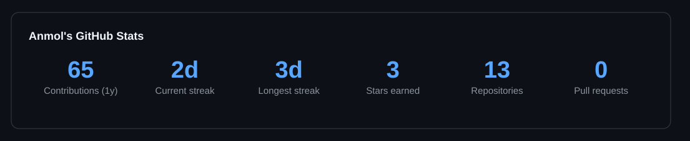
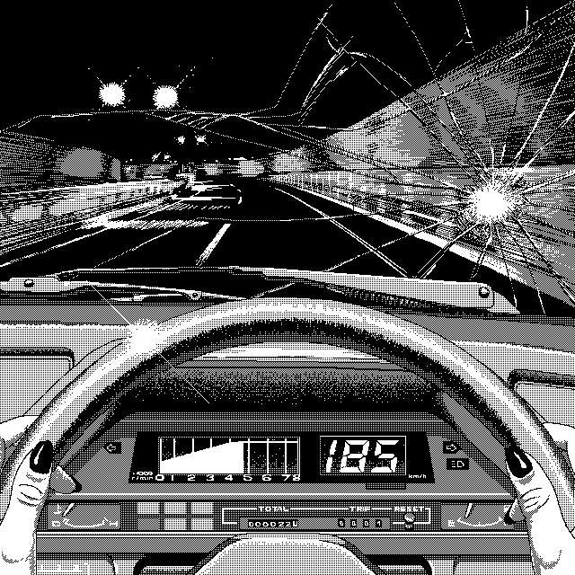

  

## About Me:

Hi, I'm **Anmol** 👋, a beginner developer who loves building useful things.

- 🔭 Currently working on **SatelliteSense**, satellite image captioning with CLIP
- 🐧 Learning **Linux system administration** and Bash automation
- 🌱 Improving my skills in **Python, Git and web development**
- 🤝 Looking to collaborate on small open-source and student projects
- 💬 Ask me about Linux scripting, automation and getting started with Git
- ⚡ Fun fact: I write my best code after a break and some chai ☕

## 💻 Tech Stack:

## 🚀 Featured Projects

| Project | What it does |
|---|---|
| [linux_automation_sprint](https://github.com/ANMOL16-IT/linux_automation_sprint) | Linux automation problems solved as small, runnable Bash projects |
| **SatelliteSense** | Reasoning-guided captioning of satellite images using CLIP |

## 📊 GitHub Stats

  

 
<table width="100%">
  <tr>
    <td width="50%" align="center">
     
    </td>
    <td width="50%" align="center">
 
    </td>
  </tr>
</table>

  

